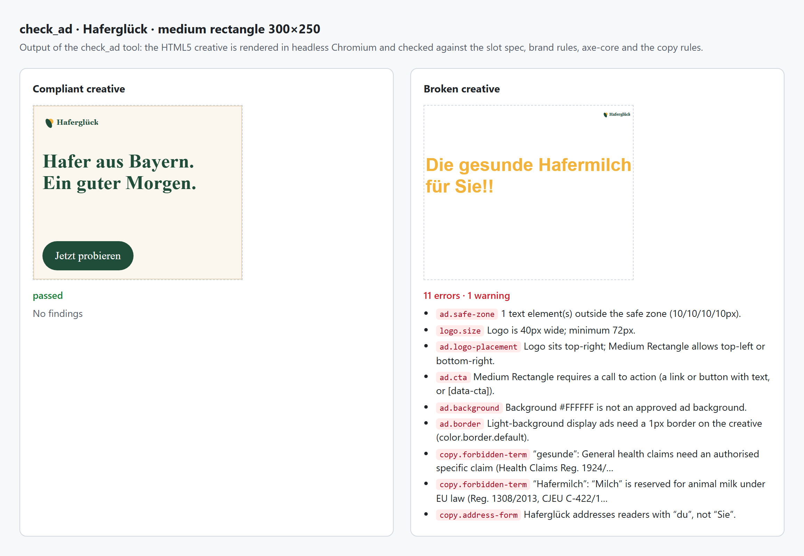

# Brand MCP server

[](https://github.com/dimitrovdaniel/brand-mcp-server/actions/workflows/ci.yml)


[](LICENSE)

A remote MCP server that gives AI agents (Claude, Cursor, Copilot, VS Code) a brand's rules, design tokens, logos and ad formats, and lets them **check their own output** against those rules before a human sees it.

- **TypeScript**, MCP TypeScript SDK **v2** (`@modelcontextprotocol/server` 2.4), spec **2026-07-28**, also serves 2025-era clients.
- **Streamable HTTP**, stateless: one web-standard `fetch` handler that runs on Node, in Docker, on Vercel and other fetch runtimes. **stdio** works for local use too.
- **OAuth 2.1 resource server**: JWT validation against your IdP (Entra ID, Okta, Auth0, Keycloak), RFC 9728 protected-resource metadata, scopes, and per-brand access from app roles.
- **Design tokens** in **DTCG 2025.10**, built with **Style Dictionary v5**, imported from **Figma Variables**.
- **Check tools** built on headless Chromium (**Playwright**) and **axe-core** (WCAG 2.1 AA).
- **Evals in CI**: deterministic tool evals on every change, plus an agent eval in which Claude must answer verifiable questions using only the tools.



<sub>Real output of `check_ad`, generated by `scripts/readme-image.ts`.</sub>

The three brands in `brands/` (Haferglück, Kiesel, Sonnfeld) are fictional German consumer brands. They show the structure and the kind of rules the tools enforce, including real German and EU advertising rules: "Hafermilch", biocide disclaimers and sunscreen claims. Replace them with your own.

---

## Quick start

```bash
npm ci
npx playwright install chromium     # for check_ad (html), check_page, check_visual
npm test                            # builds brands, runs 80+ tests
npm run eval                        # deterministic tool evals
npm start                           # http://127.0.0.1:3000/mcp  (no auth locally)
```

Connect a client to the local server:

```bash
claude mcp add --transport http brand http://127.0.0.1:3000/mcp          # Claude Code
npx @modelcontextprotocol/inspector                                      # MCP Inspector → Streamable HTTP → the URL
```

```jsonc
// Cursor: .cursor/mcp.json · VS Code: .vscode/mcp.json ("servers" instead of "mcpServers")
{ "mcpServers": { "brand": { "url": "https://brand-mcp.example.com/mcp" } } }
```

For a local child process instead of HTTP: `{ "command": "npx", "args": ["tsx", "src/stdio.ts"], "cwd": "/path/to/brand-mcp-server" }`.

---

## How an agent uses it

> *"Build a Sonnfeld newsletter header and a matching 300×250 banner."*

1. `get_brand("sonnfeld")` returns colours, fonts, the form of address (“Sie”) and the guideline index.
2. `get_tokens(format: "css")` and `get_logo(background: "color.surface.brand")` return CSS variables and the inverse logo SVG.
3. `get_ad_specs(slot: "medium-rectangle")` returns the 150 KB limit, the safe zone, the logo at a minimum of 80 px top-left or top-centre, and the CTA rule.
4. The agent writes the code, then runs `check_code`. The finding `#E2603F hard-coded → var(--sf-color-accent-default)` comes back and the agent fixes it.
5. `check_copy` flags „Sunblocker“ under EU 2006/647/EC and suggests „Sonnenschutz mit LSF 50+“.
6. `check_ad(html)` and `check_page(viewport 390×844)` both come back with `passed: true`, so the agent hands the work over.

---

## Tools

The server has twelve tools. Each one answers a whole question an agent has; none is a thin wrapper over a single data file. Every tool takes `brand`, an enum of the brand ids, so the model never has to guess a brand name. All tools are annotated `readOnlyHint` and `idempotentHint`. They return a short JSON text and `structuredContent`. Check tools also return image content when there is a screenshot.

| Tool | What the agent gets |
|---|---|
| `get_brand` | **Start here.** Summary, personality, du/Sie, fonts, semantic colours, approved colour pairs, logo versions, booked ad slots, and the index of guideline sections. |
| `get_tokens` | Tokens by group (`color.action`, `typography`, `space` …) as a list with CSS variable names, or as CSS, SCSS, JS or the DTCG 2025.10 source. Semantic tokens only, unless you ask for primitives. |
| `find_token` | Reverse lookup from a raw value (`#1f4e3b`, `rgb(…)`, `16px`, `Inter`) or part of a name. Off-palette colours come back with the nearest tokens and their ΔE. |
| `search_guidelines` | BM25 search over the guideline Markdown, in German or English, or direct access by section or page. Results carry `brand://` URIs to cite. |
| `get_logo` | The right logo version for a background, as SVG, with minimum size, clear space and approved backgrounds. Refuses backgrounds no logo is approved for. |
| `get_ad_specs` | The slots a brand books, merged with its rules: size, file types, weight, animation, safe zone, headline length, CTA, logo version, minimum width and placement, and backgrounds. Also covers organic and print formats. |
| `check_contrast` | WCAG 2.1 ratios plus the brand's own approved and forbidden pairs per usage (text, large text, UI). With only a background, it lists the approved foregrounds. |
| `check_copy` | German copy rules: banned or legally risky terms (inflections included), du/Sie, brand-name spelling, exclamation marks, mandatory disclaimers, CTA labels, and the headline length for a slot. |
| `check_code` | CSS, SCSS, HTML, JSX and Tailwind: hard-coded and off-palette colours, primitive or unknown tokens, foreign fonts, and sizes off the scale. Each finding has a line number and the token to use instead. |
| `check_ad` | Checks a creative against the slot spec from its facts. With HTML5 source it also renders the ad at slot size: overflow, safe zone, logo size and placement, CTA, background and border, fonts, palette, axe contrast, and copy. |
| `check_page` | Renders HTML (or an allow-listed URL) at any viewport. Checks axe-core WCAG 2.1 A/AA, palette, fonts, text size, line length, tap targets, horizontal overflow and logo size. |
| `check_visual` | Screenshot plus pixel analysis: palette coverage, dominant colours mapped to tokens, and whether the key brand colours are present. The image is returned so the model can judge composition itself. |

Every check tool returns the same shape: `{ passed, errors, warnings, findings: [{ rule, severity, message, where, suggestion, source }] }`. `rule` is a stable id, so evals and CI can assert on it. `source` is the `brand://` URI of the rule behind the finding.

### Resources

| URI | Content |
|---|---|
| `brand://{brand}/overview` | One-page Markdown summary |
| `brand://{brand}/tokens/{css\|scss\|js\|dtcg}` | Style Dictionary builds and the DTCG source |
| `brand://{brand}/guidelines/{page}` | Guideline pages: `essence`, `logo`, `color-and-type`, `voice-and-copy`, `imagery-and-layout`, `advertising` |
| `brand://{brand}/logos/{primary\|inverse\|mark}` | SVG |
| `brand://{brand}/rules/{color-pairs\|copy\|ad-slots\|formats}` | Machine-readable rules |

### Prompts

`review_ad`, `review_page` and `review_copy` tell the agent which tools to call, in which order, and how to report: a findings table with severity, rule, location, fix and source, followed by a verdict (*Approved*, *Approved with changes*, *Not approved*).

---

## Brand repo (phase 1)

```
brands/
  _shared/ad-slots.json        IAB display + social + DOOH slots, shared by all brands
  _shared/formats.json         organic, email and print formats
  <brand>/
    brand.json                 name, fonts, logo specs, layout and visual rules
    tokens/*.tokens.json       DTCG 2025.10 (exported from Figma Variables)
    guidelines/*.md            guidelines as Markdown, split into sections at "## "
    rules/color-pairs.json     approved and forbidden foreground/background pairs per usage
    rules/copy.json            du/Sie, banned terms, mandatory disclaimers, brand-name spelling, CTA labels
    rules/ad-slots.json        booked slots, brand defaults, per-slot overrides
    logos/*.svg
```

**Tokens** use the DTCG 2025.10 value forms: colours as `{ colorSpace, components, alpha?, hex }`, dimensions and durations as `{ value, unit }`, and references as `{color.primitive.forest.700}`. Each brand has a primitive layer (`color.primitive.*`) and a semantic layer (`color.text.default`, `color.action.primary` …). Product code and agents use only the semantic layer.

**Style Dictionary v5** (`scripts/build-tokens.ts`) builds CSS custom properties (with references kept as `var()`), SCSS, an ES module and a flat JSON index the server reads. Three small value transforms turn the 2025.10 object forms into CSS before the standard transforms run.

**Figma**: `npm run figma:export -- --file <key> --brand <id> [--mode Light]` reads the file's local variables through the Figma REST API (Enterprise plan, `file_variables:read`). It writes one DTCG file per collection. It maps colours to 2025.10 colour objects, aliases to references, FLOAT variables by scope (`FONT_WEIGHT` becomes fontWeight, everything else becomes dimension), and font-family strings to arrays.

**Validation**: `npm run build:brands` validates the whole repo and fails CI if anything is wrong:
- the DTCG structure and types;
- every token referenced by rules, logos and ad slots;
- that every approved colour pair actually passes WCAG for its stated usage;
- that the logo files exist.

It then bundles everything into one JSON file, so the server needs no file system at runtime.

---

## Authorization (OAuth / SSO)

The server is an **OAuth 2.1 resource server**, following the MCP authorization spec. It never issues tokens. For each request it:

1. answers `401` with `WWW-Authenticate: Bearer resource_metadata="…/.well-known/oauth-protected-resource/mcp"` when there is no valid token;
2. serves the **RFC 9728** protected-resource metadata, which points at your IdP, plus a mirror of the IdP's metadata;
3. verifies JWTs against the IdP's **JWKS**: signature, `iss`, `aud`, `exp`, and allowed algorithms;
4. requires the configured scope, returning `403 insufficient_scope` if it is missing;
5. reads **per-brand access** from app roles. `Brand.All` sees every brand; `Brand.Kiesel` sees only Kiesel. With `BRAND_ROLES_REQUIRED=true`, a token without a brand role sees nothing.

It also enforces a `Host` allow-list (DNS-rebinding protection) and an optional `Origin` allow-list.

### Entra ID setup

1. **App registrations → New registration**, for example "Brand MCP API".
2. **Expose an API**: set the Application ID URI (`api://brand-mcp`) and add the scope `Brand.Read`.
3. **App roles**: add `Brand.All`, `Brand.Haferglueck`, `Brand.Kiesel` and `Brand.Sonnfeld` (allowed member types: users/groups and applications). Assign them to groups under **Enterprise applications**.
4. **Manifest**: set `"requestedAccessTokenVersion": 2`.
5. Configure the server:

```bash
AUTH_MODE=oidc
OIDC_ISSUER=https://login.microsoftonline.com/<tenant-id>/v2.0
OIDC_AUDIENCE=<api-client-id>,api://brand-mcp
OIDC_REQUIRED_SCOPES=Brand.Read
OIDC_SCOPES_SUPPORTED=api://brand-mcp/Brand.Read
BRAND_ROLES_REQUIRED=true
MCP_PUBLIC_URL=https://brand-mcp.example.com/mcp
ALLOWED_HOSTS=brand-mcp.example.com
```

App-only tokens (client credentials, for CI bots) carry `roles` instead of `scp`. A `Brand.*` app role grants access.

Entra ID does not support dynamic client registration. Clients that can be configured with a pre-registered client id work directly against Entra. For clients that require dynamic registration, put an OAuth broker in front of Entra, such as a Cloudflare `workers-oauth-provider`, Auth0 or Keycloak federating to Entra. The server only needs the broker's issuer and audience.

Without `OIDC_ISSUER`, the server runs without auth for local development. It refuses to start that way in production unless `ALLOW_ANONYMOUS=true` is set explicitly.

---

## Check tools (phase 4)

`check_ad` (with `html`), `check_page` and `check_visual` render in headless Chromium:

- **Isolation**: each check gets a fresh browser context, and every network request is blocked except `data:`/`blob:` and the hosts in `BRAND_CHECK_ASSET_HOSTS` (Google Fonts by default). Live-URL checks are only allowed for `https://` hosts listed in `BRAND_CHECK_URL_HOSTS`, so a check can never reach internal services.
- **axe-core** runs with the `wcag2a`, `wcag2aa`, `wcag21a` and `wcag21aa` tags. Serious and critical violations are errors.
- **Brand rules** use computed styles (colour, background, border, font family and size, element boxes) compared against tokens with OKLab ΔE, and screenshot pixels for palette coverage.
- **Where the browser comes from**: locally and in Docker it is Playwright's Chromium. On serverless platforms set `BROWSER_WS_ENDPOINT` (a Playwright server) or `BROWSER_CDP_ENDPOINT` (any CDP browser service). Without a browser, these three tools return a clear error, and all other tools keep working.

---

## Evals (phase 3)

```bash
npm run eval          # evals/cases/tools.json + evals/client-cases/*.json
npm run eval:agent    # needs ANTHROPIC_API_KEY; EVAL_MODEL, EVAL_MIN_PASS optional
```

**Tool evals** are deterministic. There are 31 cases, one tool call each, with assertions on the result:

```json
{ "id": "copy-biocide-disclaimer", "tool": "check_copy",
  "args": { "brand": "kiesel", "text": "Der neue Hygienespüler." },
  "expect": { "passed": false, "rules": ["copy.required-disclaimer"] } }
```

The available assertions are `isError`, `passed`, `rules` (must include), `notRules`, `equals` (dot paths into the JSON result) and `includes`. HTML fixtures can be referenced as `"@fixture:goodAd"`. **Existing test cases** go into `evals/client-cases/*.json` in the same format and run with the rest.

**Agent eval**: Claude gets only the MCP tools and 15 verifiable questions. Examples: "Which CSS custom property should a Kiesel button use for its background?" and "Is the Sonnfeld headline „Ihr Sunblocker für den ganzen Tag“ allowed?" Answers are graded mechanically (exact, includes, regex, oneOf). This measures **tool design**, not just tool correctness: a question fails when the model can't find or use the right tool.

Both suites write `evals/results/*.json`, JUnit XML, and a Markdown table to the GitHub job summary.

**CI** (`.github/workflows/ci.yml`) runs on every push and pull request:

1. brand validation and the token build;
2. typecheck;
3. tests;
4. tool evals;
5. the agent eval, when the `ANTHROPIC_API_KEY` secret is set;
6. a container smoke test that builds the Docker image and calls the server over HTTP.

---

## Deploy

| Target | How |
|---|---|
| **Docker / any VM / Azure Container Apps / Cloud Run** | `docker build -t brand-mcp .`. The image is based on Playwright's, so the browser checks work. |
| **Vercel** | `vercel deploy`. `vercel.json` routes every path to `api/index.ts`, and `src/http.ts` does the routing. Set `BROWSER_WS_ENDPOINT` for the browser checks. |
| **Other fetch runtimes** | `createApp()` returns `{ fetch }`. The brand data is bundled JSON, so no file system is needed. |

The endpoint is stateless (SDK v2 per-request servers), so it scales horizontally without sticky sessions.

---

## Project layout

```
src/
  server.ts        tools, resources, prompts (createServer factory)
  http.ts          fetch handler: /mcp, OAuth metadata, auth gate, host checks, /healthz
  auth.ts          JWT/JWKS verification, Entra ID claims, brand roles
  node.ts          Node entry (npm start)        stdio.ts   stdio entry
  data.ts          brand bundle access, colour resolution
  checks/          copy, code, contrast, ad-spec, browser + render (Playwright/axe)
  lib/             colour maths (WCAG, OKLab), BM25 guideline search
scripts/           build-tokens (Style Dictionary), build-data (validate + bundle), figma-export
api/index.ts       Vercel entry
evals/             runner, cases, client-cases
tests/             unit, protocol (real MCP client over Streamable HTTP), OAuth, browser, Figma
```

## Security notes

- The server has no write tools. Brand data changes only through pull requests to this repository, which pass CI.
- Inputs are bounded: string lengths, a 50-pair contrast limit, and `maxToolInputElements`. Rendered HTML cannot make network requests except to allow-listed font hosts.
- Tokens are verified locally against cached JWKS. No token is logged or passed on.
